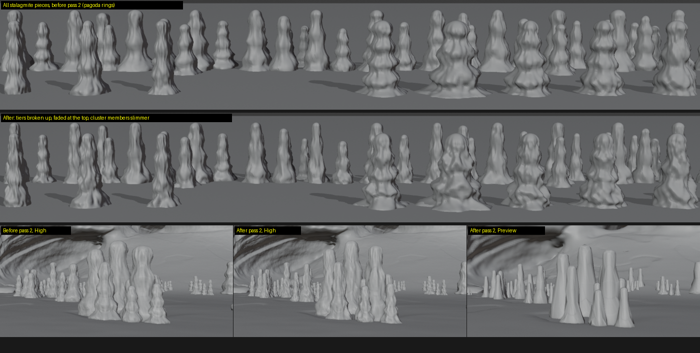
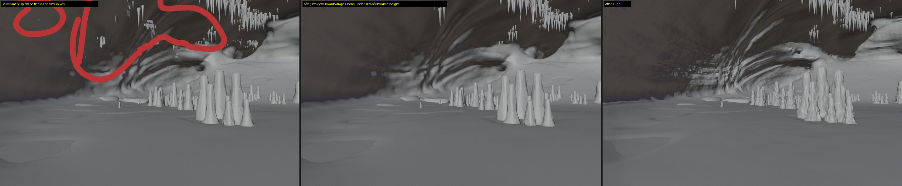
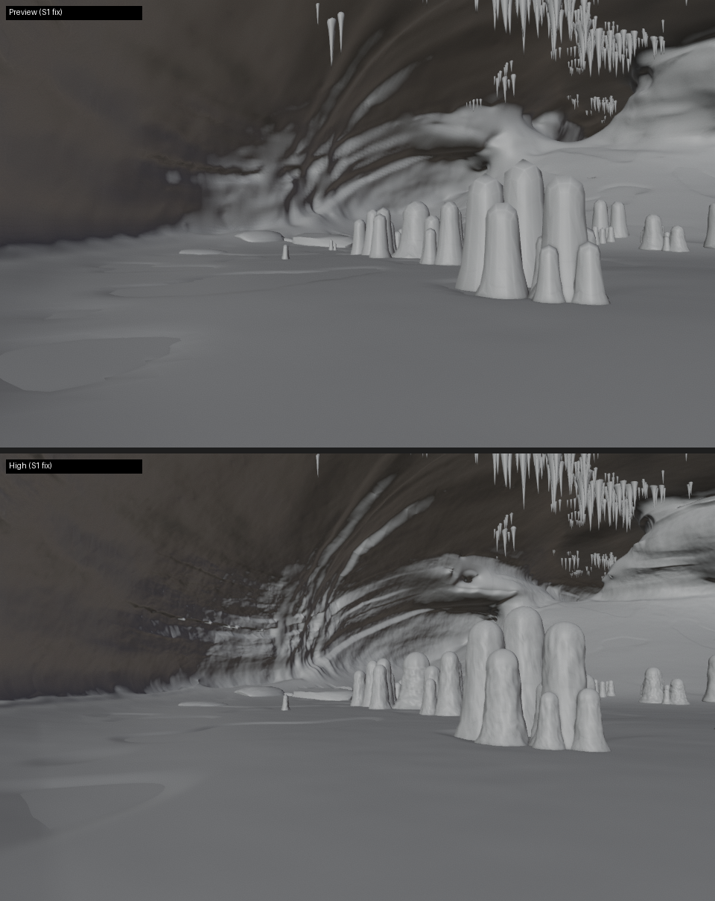
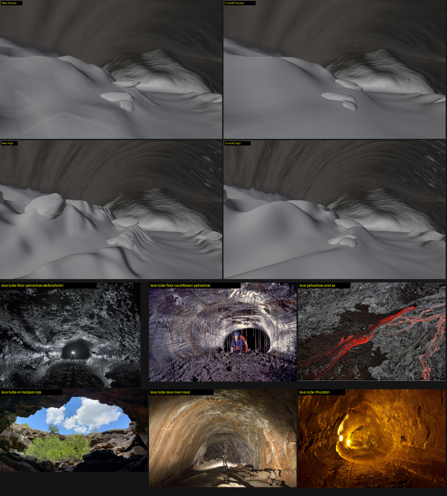
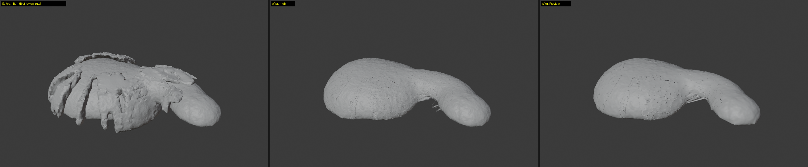
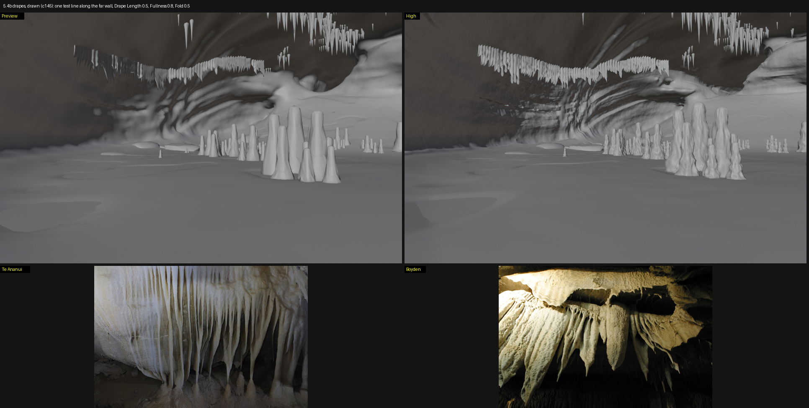
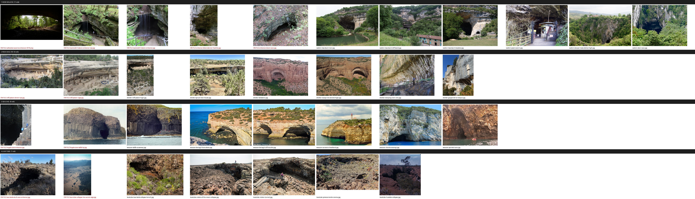

# Review list for Mike (2026-11-05)

Everything since your last look, most important first. Each item has where to look, what to check, and a blank for your call.
Boards are in `docs/m5/`. To see it live in Blender, restart Blender first: your open file has an older cave (current: cave version 183, formation library 10).

## 1. Decisions waiting on you

- [ ] **5.3 plan** ([PLAN-5.3.md](PLAN-5.3.md)): three steps (open mouth with a rolled lip, a simple cutter plus Cut Selected for Kits, a Cave Object picker on landscapes). Four questions:
  1. Lip look: the rounded, stepped rim like Dixon and Falkensteiner, with a Lip slider? (default thickness about 0.15 of the entrance width)
  2. Cutter clearance: how much rock between the cave and the landscape? (default 1 voxel, about 3-5 m in a big cave)
  3. Cut Selected on Kits: live Boolean or applied? (default live)
  4. The old built-in landscape caves (5.1): keep next to the new picker, or replace?
  - Your call:
- [ ] **What's next after 5.3:** 5.2b (drawn path), then the 5.5 gate. Same order?
  - Your call:

## 2. Formations (limestone)

- [ ] **Stalagmites reworked twice** (D182, D183): tapered cones, stacked lopsided tiers, deeper knobs, slender spires; tiers fade at the top; slimmer cluster members.
  Boards:  and against the six photos: [c139](m5/c139_stalagmite_refs_vs_ours.png)
  Check at High, close up: do they read as real stalagmites? Any pagoda rings or bulb heads left?
  - Your call:
- [ ] **No tiny stalactites** (D185, your markup): none shorter than a tenth of the entrance height (23 to 5 in your circled area).
  Board: 
  Check: is the roof now too bare anywhere, or still spiky?
  - Your call:
- [ ] **Same formations at Preview and High** (D181): 
  Known: High keeps about 7% more stalactites than Preview (a slope test runs on the finished roof).
  - Your call:
- [ ] **Formations controls grey out unless the rock is Limestone** (S6): check in the panel with Lava Tube picked.
  - Your call:

## 3. Lava and jointed

- [ ] **Lava floor crust taken out** (D184), parked for an M7 displacement map: 
  Check: the lobes alone, at High, in the passage 40-95 m in.
  - Your call:
- [ ] **Jointed pieces no longer hang out under the chamber** (D188): 
  Left, outside only: a few stretched shards under the passage-to-chamber join and thin dark crack lines on the hull. Fix now, or at the 5.5 gate?
  - Your call:

## 4. Drapes (parked, D187)

- [ ] **Drawn drapes**: a curve picked as Drape Lines hangs a curtain along it (Formations panel: Drape Lines, Drape Length, Fullness, Fold). 
  Optional: draw a curve on the roof yourself (Draw tool, projected onto the surface) and try it. Known issues in PARKING: hangs like a fence in front of a sloping wall, all one length, slab-like singles.
  - Your call:

## 5. References gathered (all from Wikimedia Commons, free licences, sources.json in each folder)

- [ ] **Cave landscape styles** (5+ each):  Notes per style in [RESEARCH-caves.md](RESEARCH-caves.md) (last section). Any style missing a look you want?
- [ ] **Stalactites, columns, entrances** (5+ each): [c146](m5/c146_refs_stalactites_columns_entrances.png)
- [ ] **Drapes** (8): [c142](m5/c142_drape_refs.png)

## 6. Housekeeping

- [ ] Push the 3 unpushed commits: `git -C E:/Projects/Cowork/apps/landscape-generator push`
- Tests: full suite 28/28 before the jointed fix; T14, T15 and T31 pass after it.
- Your review skill now requires 3+ references per feature (5 for these landscape styles); your picks and finds are logged in `~/.claude/skills/mike-review/review-log.md`.
