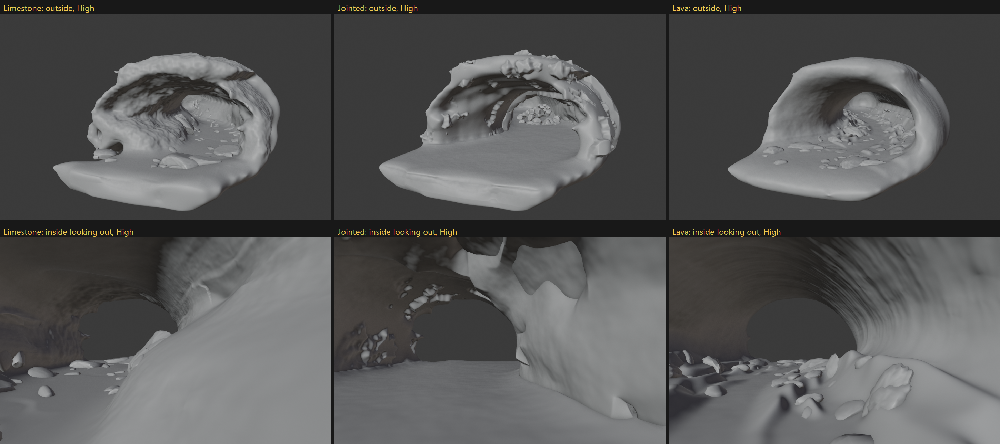

# Review list for Mike (2026-11-09)

Everything waiting on you, most important first. Each item says where to look and has a blank for your call.
Boards are in `docs/m5/`. To see the cave live in Blender, restart Blender first: the current cave is version 205.

## 0. Before anything

- [ ] **Push** the 21 unpushed commits: `git push` in `apps/landscape-generator`.

## 1. Cave mouth (5.3a): your full review

You said you'd do a full review after this pass. Current state is CAVE_VERSION 205 (D196, D197).

- [ ] **The mouth as it stands:** 
  Also: review fixes [c172](m5/c172_mouth_review_fixes.png), against references [c171](m5/c171_mouth_vs_refs.png).
  Known open (already tickets): jointed lip pale folds from inside (LG-001), limestone lip lumpy with a hollow at the
  front-left foot (LG-002), floor apron too long and saw-toothed on Jointed (LG-004).
  - Your notes:
- [ ] **Floating piles (LG-003, blocked on you):** which render, and where in it? Probably c171 ([c171](m5/c171_mouth_vs_refs.png)).
  - Render and spot:
- [ ] **Ultra check (yours):** you said you'd run Ultra yourself. Estimate is about 25-28M faces for the default cave.
  - Result:

## 2. Plan decisions

- [ ] **Ticket board** ([TICKETS.md](TICKETS.md), D201): 52 tickets in plan order. Skim the order and priorities.
  - Your call:
- [ ] **M6 before or after the spikes?** The board runs: cave fixes, M5 finish, material spike (week of 2026-11-23),
  three.js spike, then M6. M6 (cave landscapes, cliffs, export, handles) could also come before the spikes.
  - Your call:
- [ ] **Cave check in the three.js spike (LG-040):** keep the one small cave test, or Mountains only?
  - Your call:
- [ ] **Orbit team contact (LG-036, blocked on you):** who can tell us Orbit's renderer stack?
  - Name:

## 3. Reading (when you have time)

- [ ] **Feature comparison** ([RESEARCH-features.md](RESEARCH-features.md)): core set, our gaps, differentiator
  ideas. OK to fix RESEARCH-positioning.md where it still calls World Machine's Dragontail Peak "alpha" (it shipped)?
  - Your call:
- [ ] **Code review plan** (D202, bottom of [TICKETS.md](TICKETS.md)): already agreed, here for reference.

## 4. What I can start on without you

LG-051 CODING.md, LG-022 package spec, LG-018 cave realism references, LG-043 checker-note fixes, LG-044 realism
output folder. LG-001 (jointed lip folds) is first in the main lane once you've looked at section 1.
