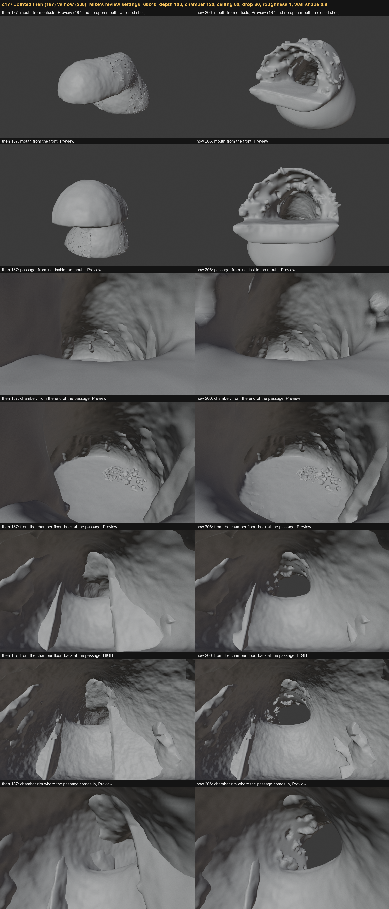
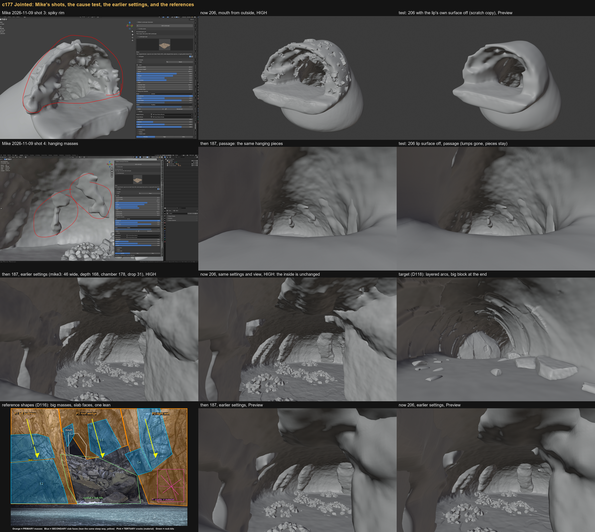

# Jointed re-evaluation: then (187) vs now (206)

Ticket LG-064. Analysis only, no code changed. Written 2026-11-10 by Claude Fable 5.2 (`claude-fable-5-2`).

Boards:

- 
  Then vs now at Mike's review settings, same camera per row. Mouth, passage, chamber at Preview, one High.
- 
  Mike's shots 3 and 4, the cause test, the earlier settings, the target and the reference shapes.

"Then" is commit `5f6ef31` (parent of `5b05c96`, CAVE_VERSION 187). "Now" is `5a8a4ed` (CAVE_VERSION 206).
Review settings: Jointed, 60 x 40, depth 100, chamber 120, ceiling 60, chamber drop 60, roughness 1, wall shape 0.8.
Lip is the default slider 0.1. That is 0.3 x the width, the same rock as Mike's "Lip 0.30" on 2026-11-09.

## Short answer

1. The spiky rim and the noise round the passage and chamber rim are new. One thing makes them: the lip's own
   surface for Jointed. Tested: with only that turned off, the spikes and lumps are gone (board 2, top right).
2. The mouth rebuild also strips the jointed pieces out of the first 48 m. At these settings that is the whole
   passage and the columns that framed the way into the chamber. This is why it "makes less sense than before".
3. The hanging masses are not new. 187 has the same ones at these settings (board 2, row 2). They are an older
   fault that these settings expose: a short passage with a big, deep chamber.
4. At the earlier settings (mike3) the inside of the cave is the same then and now (board 2, row 3).
   Nothing in the jointed masses or wall detail was changed. All the damage is in the mouth zone.

## What changed in Jointed, and why

All from the mouth work. The jointed masses (features.py 778-935) and the jointed wall detail (1485-1547) have no
changes between 187 and 206.

| Change | Where | Why (commit, decision) |
|---|---|---|
| Cave is a hollow rock body, front cut open, roof ledges, floor apron | features.py 1004-1046, 1093-1133 | Open mouth, 5.3a. `5b05c96`, D196 |
| Jointed pieces removed in the mouth, back to 0.8 x width | 1066-1070 | Pieces cut by the lip left thin plates and slivers. D196, D197 |
| Pieces grow into the rock by at most 0.8 x the wall | 1055-1057 | Pieces poked through the thinner wall. D197 |
| Mouth gets its own surface, read by position. Jointed: blocky steps | 1686-1720 | Tube detail streaked and changed between Preview and High. D197 |
| Normal wall detail faded out over the mouth, 0.45-0.75 x width back | 1695-1697, 1719 | Same. D197 |
| No edge creases at the mouth | 1358-1361 | Creased ledges pinched into plates. D196 |
| Lip range raised: slider 0.1-1 is 0.3-0.7 x width | caves.py 34-39 | Mike, LG-057. `133d5d2`, `c6e83af`, `fa32ba1` |
| Puddles on every rock, none at the mouth | 1663-1671 | Mike, LG-062, LG-058. `133d5d2` |
| Flood water tested against the cave space | 2164-2177 | Mike, LG-063, LG-066 |

## What reads worse, and the likely cause

### 1. Spiky rim (Mike's shot 3). New. Cause confirmed by test.

Board 1 rows 1-2, board 2 row 1.

- The lip surface is a noise turned into steps (features.py 1699-1705), pushed along the normal.
- Its size is `step x 0.7 x wall x 1.5` (lines 1712 and 1717). The wall is Lip x width (line 1011).
- It was tuned when the wall was 0.15 x width. LG-057 then made 0.3 x width the thinnest wall.
  Nobody rescaled the surface. At 60 m wide the wall is 18 m, so each step is about 4.7 m and the swing is up to 9 m.
- The noise cells are only 15 m across (0.25 x width, line 1699). Steps 5-9 m high on 15 m cells are spikes, not beds.
- The step riser is a third of a step wide (line 1705). At Preview that is under one face, so it tears.
- On top of this the face cut wanders 0.8 x 0.5 x width = up to 24 m in and out, on fine noise (lines 1016-1026).
- Test: a scratch copy of 206 with line 1712 set to 0. Rim is smooth ledges, no spikes. Board 2, top right.
- This is also LG-001 (pale folds from inside): same surface, seen from the other side.

Against the reference: the rockfall reference (ref_jointed_shapes.jpg) has big flat slab faces that all lean
one way. Small random bumps are the opposite of it.

### 2. "The noise around the chamber looks very very bad". New. Same cause, plus reach.

Board 1 rows 3 and 5-7.

- The mouth zone is sized by the width only: lip surface to 0.45-0.75 x width back (line 1695), pieces cut to
  0.8 x width (line 1070), creases off to 0.5-0.7 x width (line 1360).
- At 60 m wide that is 27-48 m. But here the chamber opens at about 30 m (depth 100, chamber 120).
- So the lip's lumps cover the whole passage and sit on the rim of the chamber. From the chamber floor you see
  pale faceted lumps round the hole and daylight straight through it (board 1 rows 5-7, right).
- The normal jointed wall detail is faded out in the same zone (line 1697), so the passage has no jointed
  surface left, only lumps.

### 3. "Makes less sense than the Jointed we had before". New. Pieces stripped from the passage.

Board 1 rows 5-7.

- Then: tall slabs stand each side of the way into the chamber, floor to roof. They frame the opening.
- Now: they are cut away. Piece geometry at Preview fell from 61.9k to 38.8k points (37% gone).
- Cause: line 1070 removes every piece in front of a wandering line at 0.8 x width (48 m, wandering up to 24 m).
- The cut also slices pieces part-way. Measured: one piece now spans z 7 to 40 m at y 54, over a floor at -59.
  A roof stub with nothing under it, made by the cut. In 187 it was part of a floor-to-roof mass.
- A short thin shard is left standing where a full slab was (board 1 row 6, right).

### 4. Hanging masses near the chamber (Mike's shots 4-6). Not new.

Board 2 row 2; board 1 rows 3-4, both columns.

- 187 shows the same hanging pieces from the same camera. The mouth rebuild did not make them.
- Cause: the passage masses are placed by fraction of the path, 0.25/0.3 to 0.58 (lines 787-789, 901-902, 931-932).
  At depth 100 that is 30-58 m in. The chamber already opens at 30 m. So every "passage" mass is placed out
  over the 60 m drop.
- Columns were given extra reach for this (line 836). But steps (lines 909-916), teardrops (917-935) and roof
  blocks (895-906) are short by design. Over a wall they read as blocks on the wall. Over open air they hang.
- The walkway clearance (lines 1003, 1065) then cuts through them and leaves thin necks and blobs.
- Mike's earlier reviews used mike3 (depth 168, chamber 178, drop 31). Even there 187 has columns that stop
  short of the chamber floor (board 2 rows 3-4). The review settings just make it far worse.

Against the reference: in the rockfall reference nothing hangs free. Every mass is part of a wall or the roof
wedge and runs to the ground or into another mass.

### 5. Smaller things

- Puddle dents now show on the jointed floor (LG-062, wanted). At High they read as scratch marks on the passage
  floor at mike3 (board 2 row 3, middle). Worth a look, separate from this ticket.
- From outside, the apron is a plain tongue and the hull is a smooth bag. Limestone and lava share this; not jointed's fault.
- LG-006 shards under the join: not seen in these views. Not rechecked from below.

## What still works

- The jointed masses and folds are untouched. At mike3 the inside is the same then and now (board 2 rows 3-4).
- Heaps (D178), facet-free walls (D179), clean seams (D164) all hold.
- Pieces no longer poke out of the hull (D188, D197).
- The mouth shape itself is sound with the lip surface off: stepped roof ledges, flat walk-in floor, solid rim.
  That is close to the Dixon and Falkensteiner ledges D196 aimed at.
- Honest note: neither 187 nor 206 matches the D118 target yet (layered arcs down the passage, big block at
  the end). That gap is older than the mouth rebuild. It is the next thing after these fixes, not part of them.

## Options

### A. Tame the mouth for Jointed (small)

- Jointed lip surface: tie its size to the width with a cap (about 0.03 x width, 1-2 m), not to the wall.
  Fewer, bigger cells (0.6 x width, as the jointed blocks' size J). Or off, leaving the clean ledges.
- Mouth zone length: the smaller of its width rule and about half the way to the chamber. So it never reaches the chamber rim.
- Calmer face cut for Jointed: wander about 0.3, coarser noise.
- Pros: kills the spiky rim, the rim noise and LG-001. Three or four numbers. Limestone and lava untouched.
- Cons: the mouth is plain for Jointed. Passage pieces still missing near the mouth. Hanging masses stay.
- Size S. Risk low. Tests: T14, T31.

### B. A plus fix where the pieces go (medium). Recommended.

- Everything in A.
- Pieces come back in the passage: cut them only at the lip itself (about 0.3 x width back), with a straight
  cut, not a wandering one. Drop any piece the cut touches, whole, so no stubs.
- Place passage masses by where the passage really is: from the mouth to where the chamber opens, not by
  0.3-0.58 of the path. None over the drop.
- A piece must stand on something: drop any piece whose foot is more than a few metres off the floor or whose
  top is not in the roof. Steps and teardrops only where there is wall behind them.
- Pros: answers all four of Mike's notes. Gets back the framed opening from 187. Works for short passages and
  big chambers, not just mike3. Stays inside what Mike already approved (D116-D118, D141).
- Cons: three linked changes in the mass code, which has a long fix history. The "must stand on something"
  test costs a ray per piece.
- Size M. Risk medium. Needs a board at both settings (review and mike3), Preview and High.

### C. Rebuild Jointed's primary shapes to the target (large)

- Replace columns, steps, teardrops and roof blocks with a few big leaning slabs per side that overlap down
  the passage (the D118 arcs, the reference's P1-P3 masses). The same slabs run out through the mouth, so the
  rim is slab ends, not noise.
- Pros: the only option that aims at the target and the reference directly. One system for wall and mouth.
- Cons: throws away tuned work (D141, D164, D179, D188). Big unknowns. Would hold up LG-008 and the M5 gate.
- Size L. Risk high.

## Recommendation

Do B, in two steps with a review between.

1. Step 1 is A. It is small and safe and removes the worst of it (spiky rim, rim noise, LG-001). Show Mike a board.
2. Step 2 is the pieces: back in the passage, placed by the real passage, nothing free-hanging.
3. Park C. Once B is in, compare again to the D118 target and decide if the rebuild is still wanted.

Questions for Mike before code:

- Jointed lip: plain ledges, or low broad blocks (1-2 m)?
- Hanging pieces: remove them all, or keep roof blocks that are flush with the roof?
- Is depth 100 with chamber 120 and drop 60 a case we must make look good, or should the sliders stop it?

## How this was made

- Renders: `tests/render_view.py`, view `eye` with fixed cameras, one shot per process, through `tests/blender.sh`.
  A small wrapper pre-imported the add-on from the right folder (render_view.py has the main checkout's path
  hard-coded). 187 came from a temporary worktree at `5f6ef31`, now removed.
- The mike3 rows use the `passage` view, which finds the passage centre from the mesh. The camera may differ
  by a metre or two between 187 and 206 there. All other rows use one fixed camera.
- 187 had no Lip and no open mouth, so its "mouth from outside" panels show a closed shell. Nothing to compare there.
- Cause test: a scratch copy of the add-on outside the repo with one number changed (line 1712, 0.7 to 0). Not committed.
- Piece counts: Preview mesh, points marked `lg_piece`, grouped by connection.
- Not done: Ultra, the flooded chamber (shot 6), the view from below (LG-006), other seeds, and a test of the
  face cut on its own. The fixes in the options are not tested, only the lip-surface cause is.
